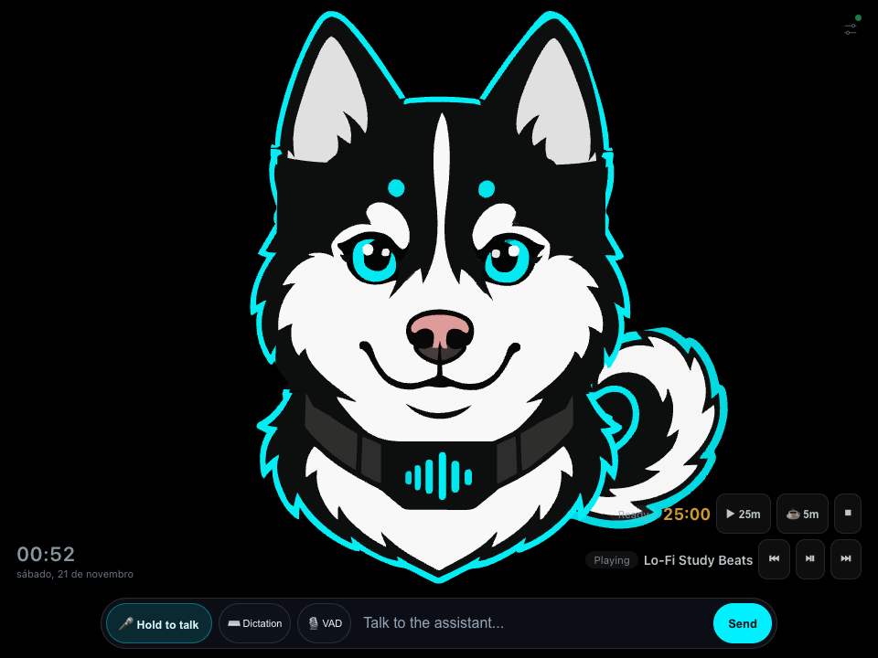
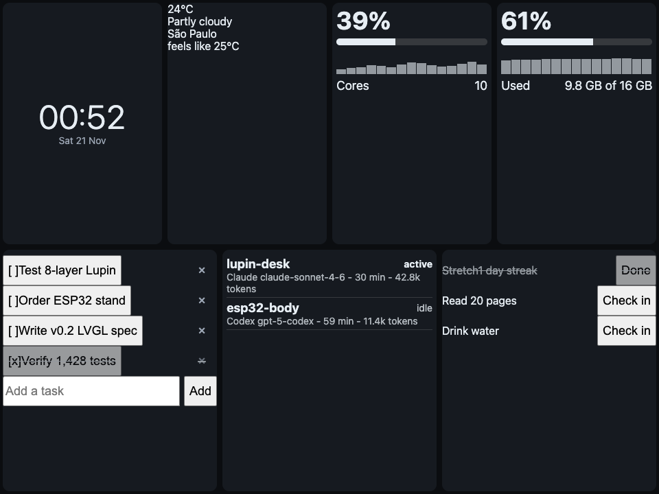
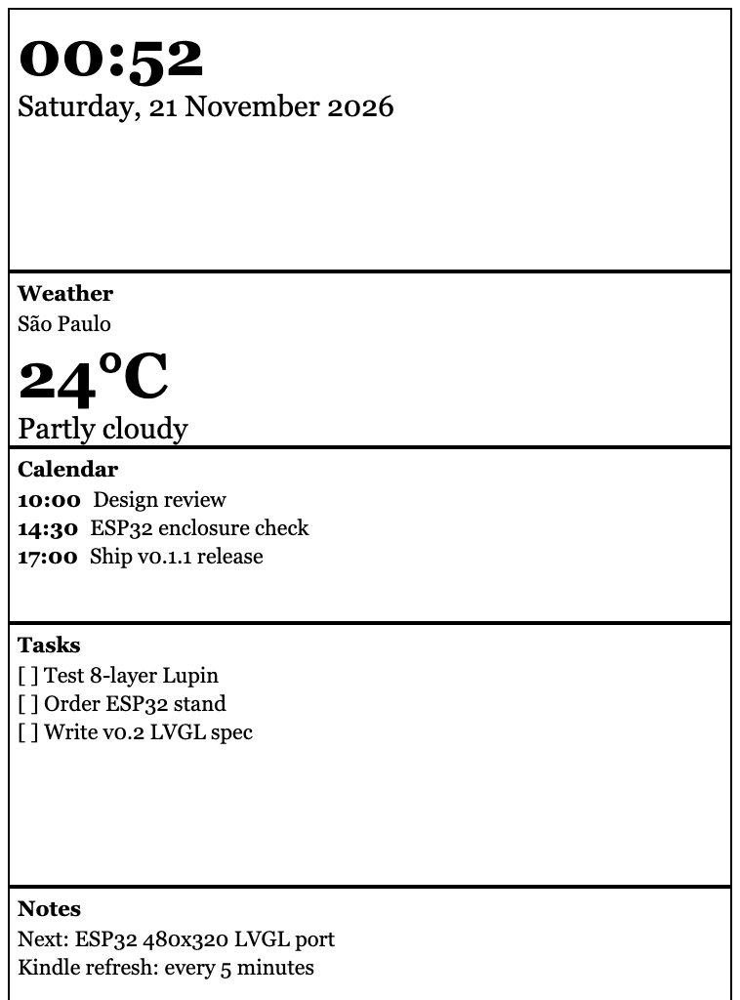
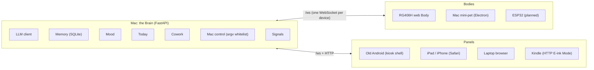

# Lupin

[](https://github.com/NathanLCR/lupin-desk/actions/workflows/ci.yml)
[](LICENSE)

Lupin is a local-first desk companion and widget panel host built in Python and vanilla JavaScript. Most desk pets have character without computer control, while Mac assistants have no physical desk presence; Lupin splits one stateful Mac **Brain** from thin **Body** and **Panel** clients on your LAN. Any old phone, tablet, handheld, or Kindle becomes a screen for Lupin or a page of desk widgets without leaving state on the device.



## Two pillars

The system separates state from display ([ADR 0002](docs/adr/0002-two-pillars-lupin-and-panels.md)):

- **Lupin (companion):** One Python Brain on your Mac manages the LLM connection, SQLite short- and long-term memory, Mood (`Affinity` and `Energy`), morning First Wake summaries, Cowork workspace tasks, and whitelisted Mac actions. Any screen can act as a **Body**, though Lupin only speaks and animates in one **Active Body** at a time (chosen by priority on the Mac). You can talk from any device; replies play on the Active Body and appear as text where you asked.
- **Panels (repurposed screens):** Spare devices become grid dashboards (`12x6`, portrait and landscape) configured in a Mac browser editor and pushed over WebSocket—or rendered as plain server-side HTML over HTTP for e-ink readers.






*Screenshots captured against a throwaway demo Brain with sample data.*

### Where it sits

From [docs/market-research.md](docs/market-research.md):

| | Companion robots | Autonomous Lamp | Taby | **Lupin** |
|---|---|---|---|---|
| Character with Mood & memory | yes | partial | light | yes |
| Acts on the computer | no | yes (agents) | yes | yes (Shortcuts, Cowork) |
| Choice of LLM | no or partial | yes | local and cloud | yes (Ollama, OpenAI, Gemini...) |
| Per-provider Data Consent | no | no | nothing leaves | yes |
| Multiple devices, one character | no | no | no | yes (Active Body) |

## Architecture

The Brain holds all credentials, SQLite state, and macOS integrations. Devices hold no secrets and send only registered Action IDs and topic subscriptions over `/ws` (or poll `/eink` over HTTP).



- **Protocol contract:** Every Body and Panel shares the versioned `/ws` frame schema in [docs/brain-body-protocol.md](docs/brain-body-protocol.md).
- **One Active Body:** Ranking follows user-defined `body_priority` on the Mac, falling back to `esp32` > `rg406h-web` > other clients.
- **No command strings from clients:** Widgets and Dock tiles trigger registered Action IDs (`^[a-z][a-z0-9_.:-]{0,63}$`). Mac control invokes `subprocess.run` with strict `argv` lists, never `shell=True`.

## What works today (and what is still unverified on hardware)

Everything below is implemented and covered by the automated test suites. Hardware checks that have not happened yet are noted explicitly.

**Lupin**
- 8-layer SVG husky (`tail`, `torso`, `collar`, `head`, `ear-left`, `ear-right`, `eyes`, `mouth`) driven by `static/lupin/expressions.json` (12 Expressions, 5 States, universal open-eye blink, 3-level speaking lip-sync with audio-reactive collar glow), LVGL-compatible 2D motion (breathing, idle sway, Expression-change squash & stretch, ear angles and twitches, eyes-only gaze, tail wag, music tilt, `prefers-reduced-motion`), 6 Tricks (`dance`, `stretch`, `nap` full-body 2-frame SVGs plus `sing`, `meditate`, `celebrate` bust effects), procedural Web Audio sound, touch/gamepad navigation, and persistent Mood (`Affinity` and `Energy`) — live RG406H/ESP32 check pending for the layered art.
- Presence: break reminders, time-of-day tone, music-reactive tilt (optional `nowplaying-cli`), and front-app Data Consent — live daily-use check pending.
- Streaming chat, SQLite memory, two-way voice with barge-in, and deterministic First Wake briefings (`Today`, verified in daily use).
- Voice-driven tasks, notes, habits, and Spotlight/local smart search ([docs/smart-search.md](docs/smart-search.md)) — live voice cross-check pending.
- Focused-app dictation via `pbcopy` + `Cmd+V` with previous-clipboard restoration ([docs/dictation.md](docs/dictation.md)) — real-app paste check pending.
- Local mode using Ollama, `mlx-whisper`, and Kokoro TTS — unit-tested with mocked engines; live Kokoro weight install and voice check pending.
- Bidirectional MCP ([docs/mcp.md](docs/mcp.md)): `POST /mcp` exposes Lupin tools on loopback, and Settings lets the Mac register external stdio/HTTP MCP servers — live Claude Code registration pending.
- Configurable reply language (`pt-BR` default or `en`), plus a frozen Electron mini-pet shell (`electron/`).

**Panels**
- Device Roles (`body`, `panel`, `body+panel`), `12x6` Layouts, ES5-compatible widget runtime (verified live on Anbernic RG406H; Moto G5 and iPad pending).
- Mac-only Layout editor at `/editor` with live device preview, templates, and masked `.env` credentials store.
- Everyday widgets (clock, calendar, weather, Pomodoro, timers, notes, checklist, habits) — RG406H render verified (small `3x3` notes tile clips the Add button in Android WebView; iPad pending).
- Mac monitoring widgets (CPU, memory, disks, network, top processes via `psutil`) — live device check pending.
- AI coding widgets and Claude Code hooks: live session tracking, Panel permission approval prompts (with Signal Expression hold and restore on release), and hooks install/remove in Settings — live Claude Code session check pending.
- Control Deck and automation: Mac volume and mic mute, multi-step macros, rate-limited incoming webhooks (`POST /hooks/{secret}` with secret rotation), automation rules, `panel:goto` page switching, whitelisted `app.activate`, and Mac Settings UI — live hardware check pending.
- Panel image editor: upload, crop, resize, compress, convert, and macOS Vision background removal (automatically compiled Swift helper recompiled on source change), EXIF orientation baking, GPS stripping on saved outputs, and voice Action integration — live device check pending.
- Signals bus pushing Brain events (Claude Code prompts, timers, webhooks, rules, habits) to subscribed Panels.
- Android kiosk APK shell (`minSdk 24` for Android 7+, reconnect backoff, boot receiver) built via `scripts/build_android_apk.py` (verified on RG406H; Moto G5 pending).
- E-ink Mode at `/eink`: plain server-rendered black-and-white HTML with no JavaScript or external assets, built for old Kindle WebKit browsers (Kindle device check pending).

Cut on purpose ([ADR 0001](docs/adr/0001-companion-first-brain-and-body.md)): standalone Stream Deck, standalone Live Dock, Ambient Display, and Screen Modes.

## Quick start (macOS)

Requires Python 3.11+ and an OpenAI-compatible LLM endpoint (cloud or local Ollama).

```bash
python3 -m venv .venv
.venv/bin/pip install -e ".[dev]"
cp .env.example .env
```

Optional local voice extras: `".[stt]"` for Apple silicon `mlx-whisper` and `".[tts]"` for Kokoro TTS (`brew install espeak-ng` is also needed for Portuguese).

Set `LLM_BASE_URL`, `LLM_API_KEY`, and `LLM_MODEL` in `.env` (for local Ollama: `LLM_BASE_URL=http://127.0.0.1:11434/v1`). Then start the Brain:

```bash
.venv/bin/uvicorn app.main:app --host 0.0.0.0 --port 8000
```

Open on the Mac or another device on your Wi-Fi (`http://<your-mac-ip>:8000`):

- `/` — Body (Lupin's face and chat)
- `/panel` — Panel runtime
- `/editor` — Layout editor (Mac only; `403` from remote hosts)
- `/eink` — E-ink Mode (static HTML for Kindle)

**Microphone over Wi-Fi:** Browsers block `getUserMedia` on plain HTTP outside localhost. Run `.venv/bin/python scripts/setup_https.py` to generate a self-signed cert in `certs/` and connect over HTTPS on port `8443`.

**Optional targets:** `.venv/bin/python scripts/build_android_apk.py` builds `dist/desk-assistant-rg406h.apk` (requires Android SDK build tools), `.venv/bin/python scripts/generate_lupin_png.py` exports all 34 indexed `480x320` ESP32 PNG layers from `static/lupin/` (111 KB total, largest 11.3 KB against the 20 KB per-layer budget; requires dev-only `pillow` and `resvg-py`), and `cd electron && npm install && npm start` launches the Mac mini-pet.

## Security model and trade-offs

Lupin assumes a **trusted single-user home LAN** ([ADR 0002](docs/adr/0002-two-pillars-lupin-and-panels.md)):

- By default (`DESK_REQUIRE_TOKEN` unset), devices on your Wi-Fi connect to Panels and `/ws` without an access token. Anyone on the same Wi-Fi can view Panels and trigger Panel actions, including pressing **Allow** on a Claude Code approval prompt. Set `DESK_REQUIRE_TOKEN=1` (and optionally `DESK_ACCESS_TOKEN` in `.env`) to require a token from non-loopback clients. Do not port-forward the Brain or run it on untrusted networks.
- **No shell execution:** Mac control runs fixed `argv` lists against an explicit whitelist in `app/mac_control.py`, never `shell=True`.
- **Loopback-only Mac controls & DNS-rebinding guards:** `POST /mcp`, `/api/mcp/*`, `PUT /api/data-consent`, `PUT /api/presence`, and `/api/control/*` write/rules routes reject non-loopback peers and non-localhost `Host`/`Origin` headers (and require `application/json` on writes) to block DNS-rebinding attacks.
- **Secret isolation:** `SecretRedactingFilter` strips API keys, tokens, and incoming webhook paths (`/hooks/...`) from logs; `.env` credentials are never serialized to clients; edited image outputs have GPS metadata stripped.
- **Per-provider Data Consent:** Calendar, email, Spotlight file snippets, and the Mac's front app (app name and window title) leave the Mac only when explicitly consented for the active provider/host; switching providers clears consent. Local loopback Ollama skips cloud consent.

## How it was built

An earlier agent-swarm build produced too many half-finished surfaces and was scrapped to a snapshot branch. The rebuild follows [ADR 0001](docs/adr/0001-companion-first-brain-and-body.md), [ADR 0002](docs/adr/0002-two-pillars-lupin-and-panels.md), [GLOSSARY.md](GLOSSARY.md), and a strict spec-then-code gate ([AGENTS.md](AGENTS.md)).

We also benchmarked agent team structures across nine issues in [docs/agent-workflow-report.md](docs/agent-workflow-report.md):

- **1-Sonnet baseline vs. Sonnet lead + 4 Haiku coders (Issue 07, Dictation):** The single Sonnet agent used **4.3x fewer tokens** (`133,336` vs. `572,063`), finished faster (`3m33s` vs. `5m11s`), wrote roughly a third as much code, and passed review after one clipboard-cleanup fix. The 4-Haiku nested build hit 3 blocking integration bugs and was reverted.
- **Overhead and review findings:** Across 34 Haiku coder tasks, ~60% of coder tokens (`2.35M` of `3.93M`) went to fixed per-subagent startup context (~69k each). Lead-only diff reviews missed boundary bugs; fresh Sonnet reviewers caught blocking integration or security flaws in 6 of 9 reviewed issues, including a DNS-rebinding RCE on `/api/mcp/*` and two timer/resource leaks.

## Tests

[](https://github.com/NathanLCR/lupin-desk/actions/workflows/ci.yml)

Both suites run automatically on push and pull request via [.github/workflows/ci.yml](.github/workflows/ci.yml):

```bash
.venv/bin/python -m pytest -q            # 919 passed
node --test tests/frontend/*.test.cjs    # 509 passed
```

## Roadmap

- ESP32-S3 (`Guition JC3248W535`, 480x320 LVGL) Body firmware, optional cropped-sprite PNG export, and hardware demo.
- Incremental evolutions on top of the 8-layer Lupin 2D base (accessories art such as headphones/Pomodoro cues, richer eye and mouth motion, and new Tricks).
- Live hardware verification on Moto G5, iPad Safari, Kindle E-ink Mode, and RG406H checks for layered Lupin and recent Panel widgets.

## License

[MIT](LICENSE), copyright 2026 Nathan Rocha.
