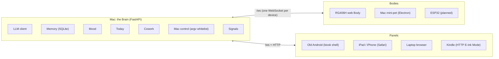
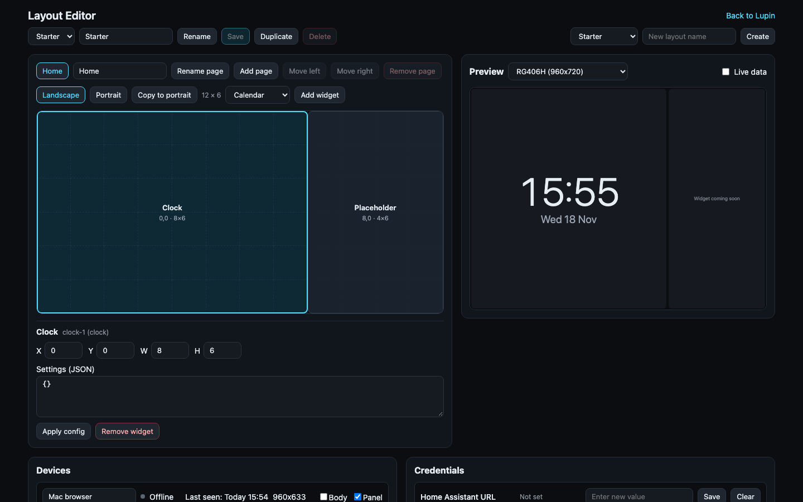

# Lupin

A desk companion that actually works.

Lupin is a husky with a Mood, a memory and a voice. He lives on a small screen on your desk, talks to the LLM you choose, and does real work on your Mac. The same Mac also drives **Panels**: configurable dashboards on the old tablets, phones and e-readers you already own.


## What it is

The project has two pillars (see [ADR 0002](docs/adr/0002-two-pillars-lupin-and-panels.md)).

- **Lupin** is the companion. A Python **Brain** on the Mac holds the LLM connection, short and long-term memory, Mood (Affinity and Energy), the morning briefing, Cowork (your personal workspace of state files and runnable tasks, with approval for anything beyond reading) and a whitelisted set of Mac controls. A **Body** is anything that shows his face and carries his voice: a web page on an Anbernic RG406H handheld, a desktop mini-pet, and later an ESP32.
- **Panels** turn spare devices into dashboards. You pick a Layout (pages of widgets on a grid) in a Mac editor, assign it to a device, and the device renders it live. It runs on old Android phones through a kiosk shell, iPads and iPhones in Safari, any browser, and Kindles through a static E-ink Mode.

Where it sits, from [the market research](docs/market-research.md):

| | Companion robots | Autonomous Lamp | Taby | **Lupin** |
|---|---|---|---|---|
| Character with Mood and memory | yes | partial | light | yes |
| Acts on the computer | no | yes (agents) | yes | yes (Shortcuts, Cowork) |
| Choice of LLM | no or partial | yes | local and cloud | yes (Ollama, OpenAI, Gemini, ...) |
| Per-provider data consent | no | no | nothing leaves | yes (Data Consent) |
| Several devices, one character | no | no | no | yes (Active Body) |

Lupin does not work offline yet. A fully local mode (Whisper STT, Kokoro TTS, Ollama) exists, with its live voice check still pending.

## Architecture

The Brain is the only place with state and secrets. Every device opens one WebSocket to it and never talks to anything else.



- One device can be a Body, a Panel or both. Roles are set on the Mac; a new device starts as a Panel.
- Exactly one Body is the **Active Body**: the one Lupin speaks through, chosen by a priority order you set on the Mac. You can talk to him from any device; the reply plays on the Active Body and the device you spoke from gets the text.
- Devices send Action IDs and topic subscriptions, never commands. The full frame list is in [docs/brain-body-protocol.md](docs/brain-body-protocol.md).

## Features that exist today

Everything below is built and covered by tests. "Pending" marks checks on real hardware or in daily use that have not happened yet.

**Lupin**
- Layered SVG husky with Expressions, procedural sound, touch and gamepad input, and a Mood that changes with how you treat him.
- Streaming chat with cognitive memory, two-way voice with barge-in, and a First Wake greeting on the first interaction of the day.
- Tasks, notes and habits by voice, and smart search over your files (live voice check pending).
- Dictation into the focused Mac app (real-app paste pending).
- Fully local mode with Whisper and Kokoro (Kokoro install and live voice check pending).
- Lupin as an MCP server, so Claude Code can call him (real registration pending). See [docs/mcp.md](docs/mcp.md).
- Reply language is a setting, Brazilian Portuguese by default.
- Mac mini-pet in Electron.

**Panels**
- Device Roles, Layouts and a widget runtime with portrait and landscape grids (RG406H test pending).
- Mac Layout editor at `/editor` with a live preview, templates and a credentials store (values stay on the Mac; the API returns only a masked preview).
- Everyday widgets: clock, calendar, weather, timers, notes, checklist, habits (device test pending).
- Signals: Brain-side events such as Claude Code approval prompts pushed to Panels as topics.
- Android kiosk shell for old devices, built with `scripts/build_android_apk.py` (device test pending).
- E-ink Mode at `/eink`: server-rendered HTML with no modern JS, for a Kindle (device test pending).



Cut on purpose ([ADR 0001](docs/adr/0001-companion-first-brain-and-body.md)): the Stream Deck, the Live Dock as a product, Ambient Display and Screen Modes.

## Quick start (macOS)

You need Python 3.11 or newer and an LLM endpoint.

```bash
python3 -m venv .venv
.venv/bin/pip install -e ".[dev]"
cp .env.example .env
```

Optional extras: `".[stt]"` for local speech-to-text (mlx-whisper, Apple silicon) and `".[tts]"` for Lupin's local voice (Kokoro; also `brew install espeak-ng`).

Edit `.env` and set `LLM_BASE_URL`, `LLM_API_KEY` and `LLM_MODEL`. Any OpenAI-compatible provider works, including a local Ollama (`LLM_BASE_URL=http://127.0.0.1:11434/v1`).

```bash
.venv/bin/uvicorn app.main:app --host 0.0.0.0 --port 8000
```

- `http://127.0.0.1:8000/` is a Body (Lupin's face and chat).
- `http://127.0.0.1:8000/panel` is a Panel.
- `http://127.0.0.1:8000/editor` is the Layout editor (Mac only).

From another device on your Wi-Fi, open `http://<your-mac-ip>:8000/`. Without `DESK_ACCESS_TOKEN` in `.env`, the Brain prints a fresh access token at every start; localhost never needs one.

**Microphone over the LAN.** Browsers only allow the microphone on HTTPS or localhost. Run `.venv/bin/python scripts/setup_https.py` to create a local certificate in `certs/`, then use the HTTPS address it prints.

**Android.** `.venv/bin/python scripts/build_android_apk.py` builds and signs the APK into `dist/`. It needs the Android SDK build tools on your machine.

**Mac mini-pet.** `cd electron && npm install && npm start`.

## Security model

Lupin is a single-user, home-LAN project. The LAN is trusted ([ADR 0002](docs/adr/0002-two-pillars-lupin-and-panels.md)). Read the risk before you expose it:

- Panels connect without the access token. Anyone on your Wi-Fi (a guest, a compromised IoT device) can view every Panel and send any action a Panel can send. That includes pressing Allow on a Claude Code approval prompt.
- Do not port-forward the Brain, and do not run it on a network you do not trust.

What still holds, whoever is on the network:

- **Action IDs only.** Devices send registered IDs. Nothing from a device is run as a command.
- **No shell.** Mac control uses `subprocess.run` with an argv list and a strict whitelist. Never `shell=True`.
- **Credentials stay on the Mac.** The editor writes them to `.env` on the Mac, the API returns only a masked preview, and widgets get data from the Brain.
- **Secret redaction.** Logs filter API keys and tokens; `LLM_API_KEY` never appears in HTTP or WebSocket responses.
- **Data Consent.** Calendar, email and file contents reach an LLM provider only if you allow that provider. Without consent, none of it leaves the Mac. Calendar and email are read-only.

## How it was built

The project came from a swarm of agents building everything at once, and most of it was cut. The rebuild runs on written decisions and a hard gate between deciding and coding.

- **ADRs and a glossary.** [ADR 0001](docs/adr/0001-companion-first-brain-and-body.md) sets the product direction and [ADR 0002](docs/adr/0002-two-pillars-lupin-and-panels.md) the two pillars. [GLOSSARY.md](GLOSSARY.md) fixes the vocabulary, so code, docs and prompts use the same words.
- **Spec-then-code gate.** Planning and specs are done in sessions that write no feature code. Builders get a grilled spec from `.scratch/lupin-foco/` or `.scratch/panels/` and do not make product decisions. [AGENTS.md](AGENTS.md) holds the rules.
- **Measured, not assumed.** [docs/agent-workflow-report.md](docs/agent-workflow-report.md) compares setups across nine issues. Main findings:
  - One Sonnet agent per issue (baseline) cost about 4x fewer tokens than a Sonnet lead with four Haiku coders on the same issue (133k against 572k), and wrote about a third of the code.
  - The nested build had three blocking issues in review and was reverted. The baseline passed after one small fix.
  - A fresh reviewer found blocking problems in 6 of the 9 issues it checked, including a DNS-rebinding remote-code-execution hole in an MCP route.
  - The lead's own review of each coder's diff caught almost nothing, because bugs sat where pieces joined, not inside them.

## Tests

```bash
.venv/bin/python -m pytest -q            # 752 passed
node --test tests/frontend/*.test.cjs    # 447 passed
```

There is no CI yet. Both suites run locally before each commit.

## Roadmap

- ESP32 Body with a small screen and speaker, and a demo video once it exists.
- P08 Mac monitoring widgets.
- P09 AI coding widgets (Claude Code session state on a Panel).
- P10 Control Deck and Automation widgets.
- Presence: Lupin reacts to you being at the desk.
- Image editor as a Panel widget.
- Device tests on the RG406H, Moto G5 and Kindle, listed above as pending.

## License

[MIT](LICENSE), copyright 2026 Nathan Rocha.
